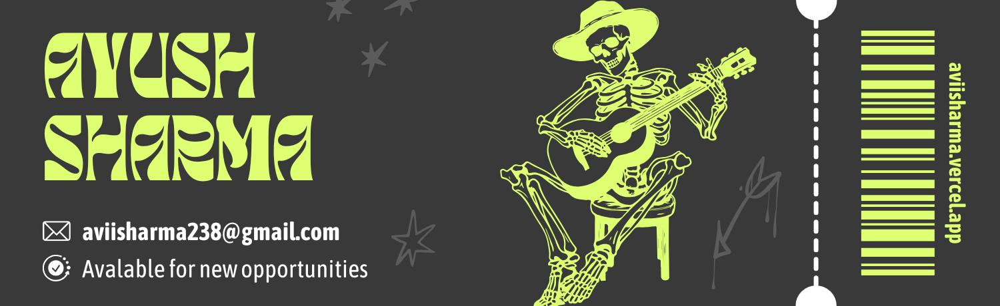

  

    

  <h1 align="center">
    
  </h1>

  

    <b>Full Stack Engineer & UI Crafter</b> based in India • Building modern interfaces, developer tools, and fluid motion libraries.
  

  

    
    
    
    
    
  

---

### 👨‍💻 About Me

- 🔭 Currently building **[ParallaxUI](https://github.com/aviisharma238/parallaxui)** — an expressive, spatial UI component collection built for depth and seamless parallax interactions.
- 🛠️ Crafting web applications and developer tools with **Next.js**, **TypeScript**, and **Tailwind CSS**.
- 🌱 Deepening knowledge in **Linux Systems Architecture**, **High-Concurrency Backend Systems**, and **Creative Motion Design (GSAP / Framer Motion)**.
- 💬 Ask me about **Next.js (App Router), React 19, TypeScript, UI/UX Engineering, AST Parsers, & Supabase**.
- 📝 Sharing development notes and architecture breakdowns on my **[Blog](https://aviisharma.vercel.app/blog)**.
- ⚡ **Fun Fact**: Obsessed with mechanical keyboard acoustics, design tokens, and sub-millisecond micro-interactions.

---

### 🚀 Featured Projects

| Project | Description | Tech Stack | Links |
| :--- | :--- | :--- | :--- |
| **[ParallaxUI](https://github.com/aviisharma238/parallaxui)** | Modern, depth-focused UI component collection engineered for fluid spatial motion and parallax interactions. | `React` `Next.js` `Tailwind CSS` `Framer Motion` | [Code](https://github.com/aviisharma238/parallaxui) |
| **[CodeAYNA](https://codeayna.vercel.app/)** | Automated syntax translation across 50+ programming languages powered by AST parsing. | `Next.js` `TypeScript` `AST Engine` `Tailwind CSS` | [Live Demo](https://codeayna.vercel.app/) • [Code](https://github.com/aviisharma238/codeayna) |
| **[CapsLK](https://github.com/aviisharma238/CapsLK)** | Interactive acoustic mechanical keyboard simulator with zero-latency keystroke telemetry. | `React` `Next.js` `Web Audio API` `Framer Motion` | [Code](https://github.com/aviisharma238/CapsLK) |
| **[Minimal Wall](https://aviisharma.vercel.app/work)** | High-resolution aesthetic wallpaper platform with intelligent color discovery and multi-aspect filtering. | `Next.js` `React` `Tailwind CSS` `Lucide` | [Overview](https://aviisharma.vercel.app/work) |
| **[ITEngineersIndia](https://github.com/aviisharma238/itengineersindia)** | Modern, accessible agency platform engineered for sub-second page loads and inquiry conversion. | `Next.js` `Tailwind CSS` `Framer Motion` | [Code](https://github.com/aviisharma238/itengineersindia) |

---

### 🛠️ Tech Stack & Tooling

**Frontend & Architecture**
 

 

**Backend & Databases**
 

 

**Cloud, DevOps & Systems**
 

 

**Design & Creative Tools**
 

---

### 📊 GitHub Analytics

  
  

 

  

 

  

---

  Crafted with precision by <b>Ayush Sharma</b> • Powered by Next.js & Open Source

